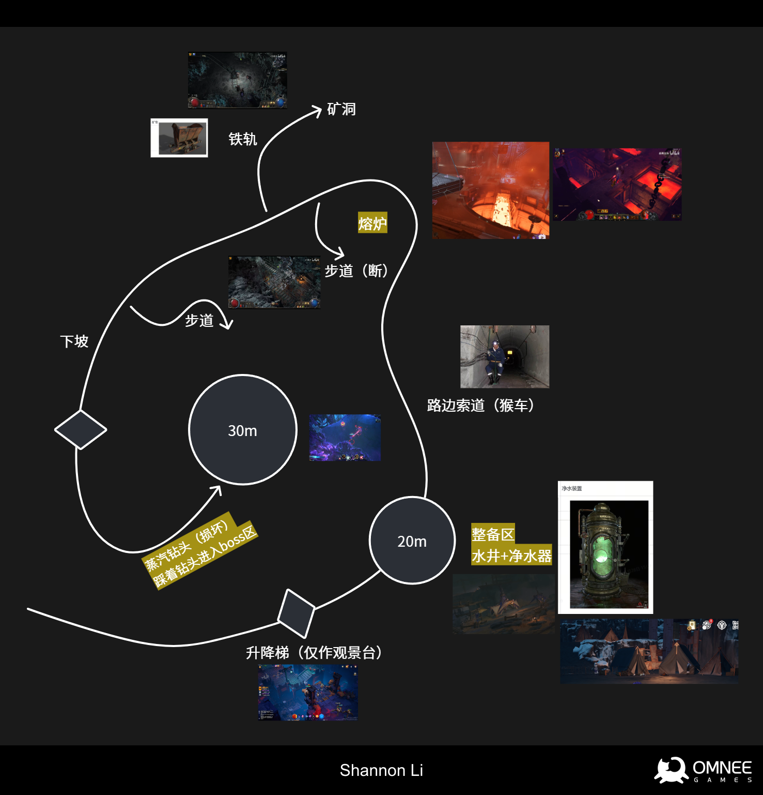
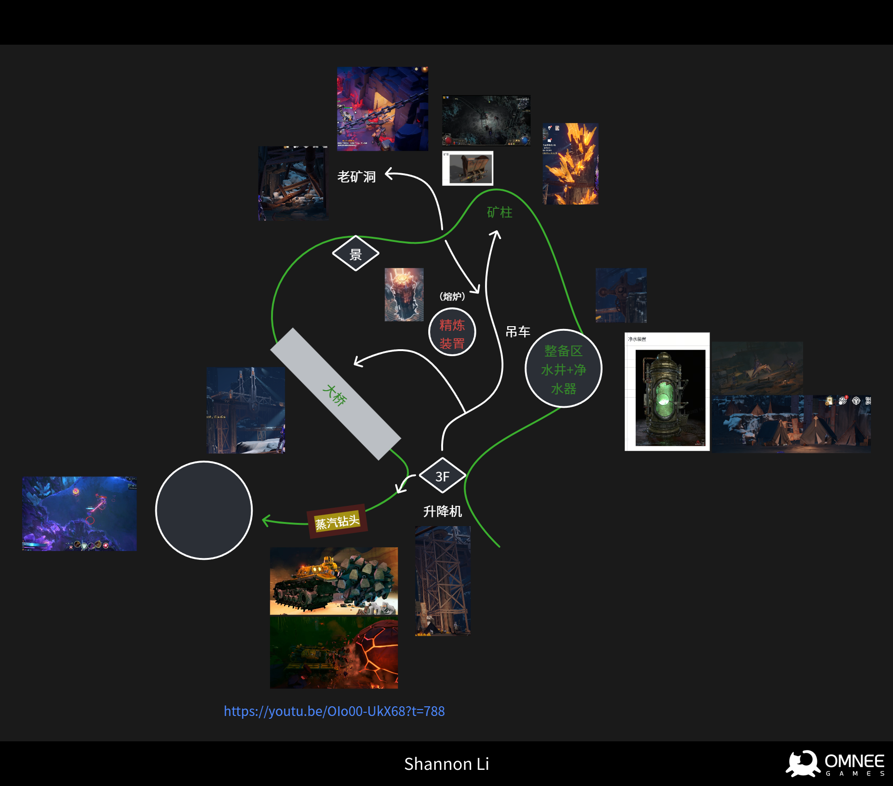
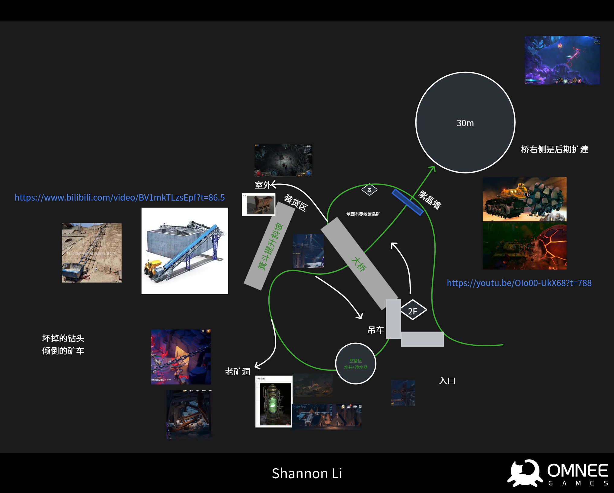
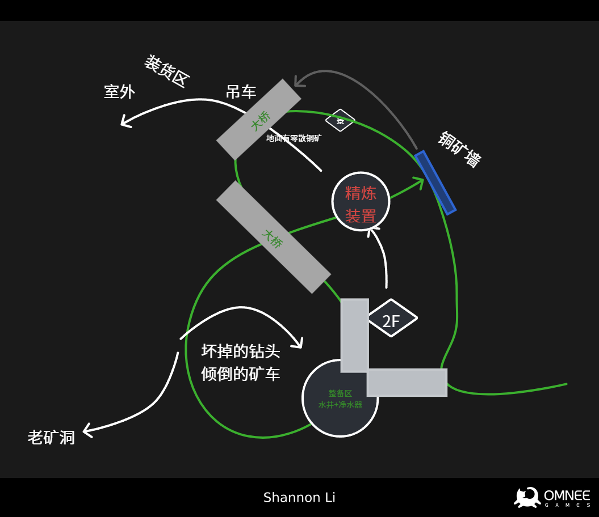
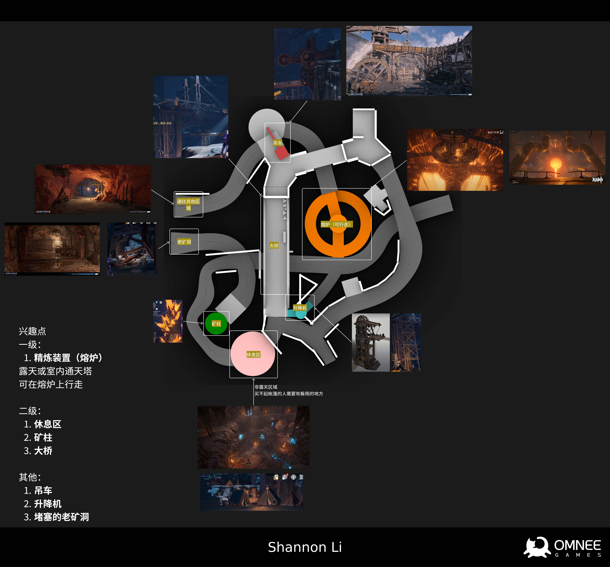
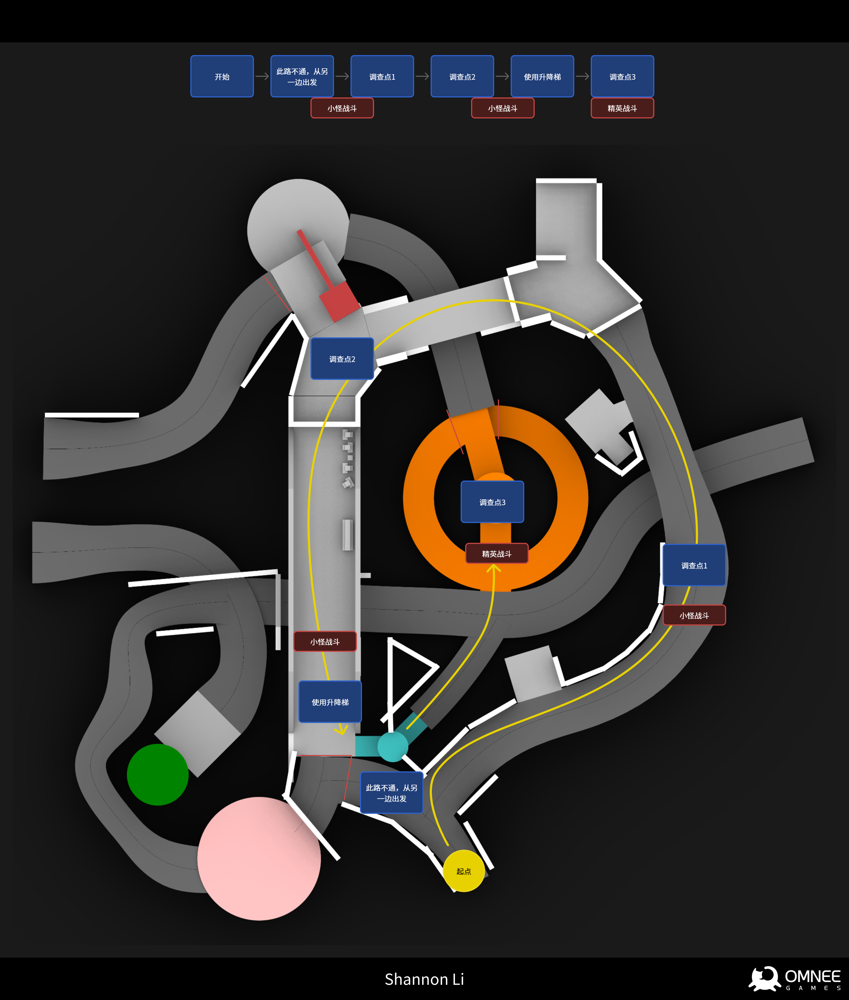
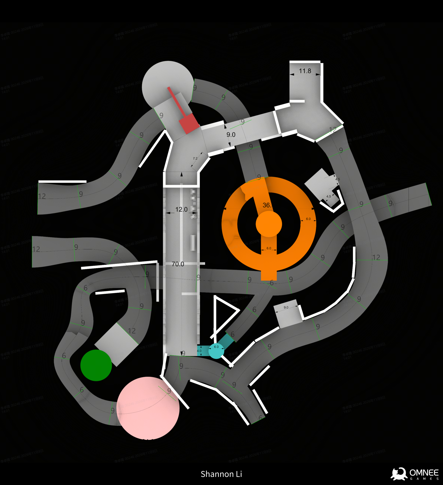
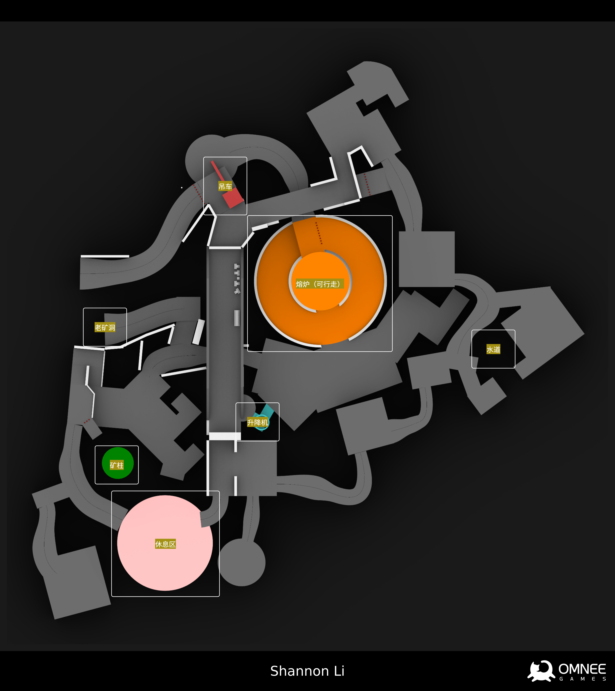
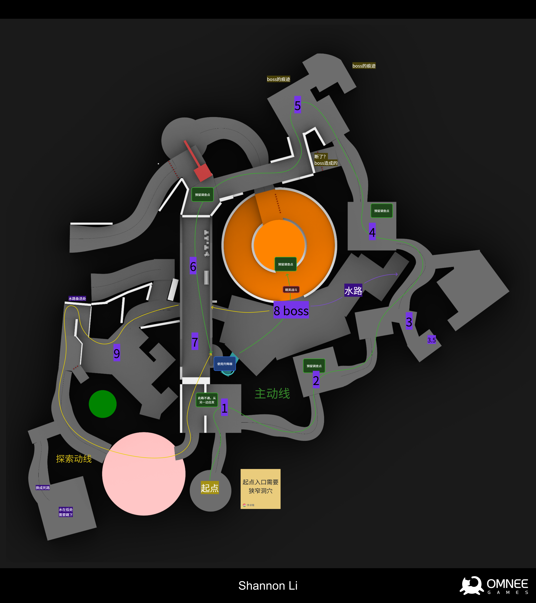
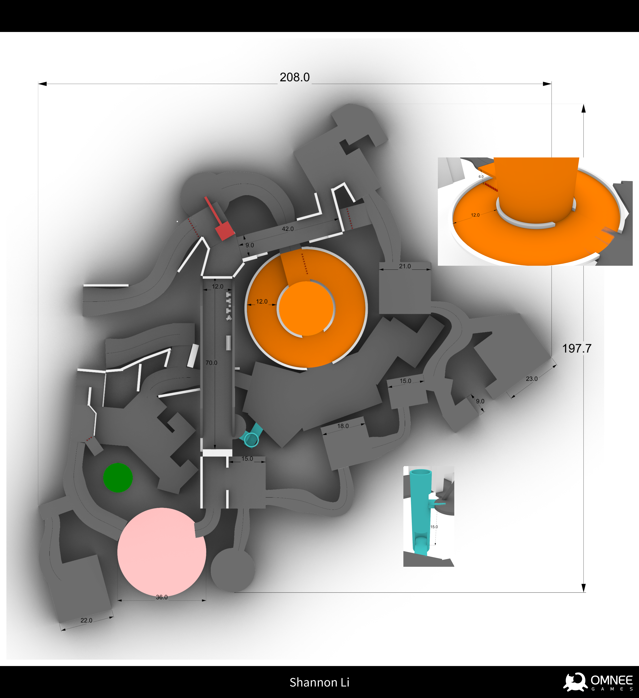

When I need to design a completely new level, these are the first things I think about:

**Setting:** What kind of world does this level belong to?

**Scale:** How long do we want the gameplay to last?

**Experience:** What do we want the player to feel?

## Sketches

When I learned that the next level in our game would be set in a mine, I excitedly started looking for directions I could sketch out. I tried to gather as much of a sense of the atmosphere of a “mine” as I could. For a fantasy mine, I thought there was room for glowing minerals, enormous pools of scorching lava, and exaggerated mining and smelting machinery. I kept the overall map within a space roughly 200–300 meters on each side.

In iteration 1, I planned to make a vast, hidden amethyst cavern the level's final secret, with a dramatic difference in atmosphere between its interior and the surrounding mine. It would feel as though the workers had been mining here when they encountered some terrifying presence in the amethyst cavern that they could not overcome. But this would leave the level's central objective out of sight throughout the journey. Under these circumstances, a hidden final area was not a very good choice.

So, in iteration 2, I decided to use a large mining machine as the level's central anchor, build paths around it, and include a little room for exploration. On entering the map, players would pass through a long, narrow tunnel and see the enormous machine for the first time. They would then move around it, gradually discovering more spaces, until they finally reached the amethyst wall it was excavating. But the machine was not large enough to hold together such an enormous cavern space.

Iteration 3 explored using a bridge to divide the level into two clearly distinct spaces on either side. This would let us reserve an area for a second round of exploration after the mission was over.

Iteration 4 explored a huge smelting installation. Its cylindrical structure ran through the full height of the cavern, continually giving players new views and a sense of reward as they explored. Since the final encounter in this level had its own specially designed gameplay, we eventually took the amethyst cavern, which had survived through the previous iterations, out of the level to build separately when we needed it later.


| Iteration 1 | Iteration 2 | Iteration 3 | Iteration 4 |
| :---: | :---: | :---: | :---: |
|  |  |  |  |


Looks good!

## Whitebox

During the whitebox stage that follows, I focus on testing the scale and pacing of the whole level: the sense of weight in the player's movement, the framing of views, and how combat, quests, and gameplay can come together organically in this space.

### Iteration 1


| Main annotations | Flow layout | Reference dimensions |
| :---: | :---: | :---: |
|  |  |  |


Once the first whitebox was complete, we finally had a chance to put our character into the map and tune the sense of weight in their movement. This was the first map in our game built for traversal with a freely controlled 3D camera. We ran several tests in this whitebox and arrived at the gold standard for our character's 3C system. Based on that standard, the studio now had a formal protocol for developing subsequent maps.

Of course, once the first whitebox had settled these things, it was time to iterate. A few problems had become apparent: after the entrance, almost every space was a long, narrow passage. The lack of breathing room made moving through the level feel quite oppressive. The stretch just after turning right inside the entrance was especially uninteresting to traverse. It lacked the kind of dynamics that could move the player.

I made giving the level more room to breathe during traversal and exploration the goal of the next iteration.

### Iteration 2


| Main annotations | Flow layout | Reference dimensions |
| :---: | :---: | :---: |
|  |  |  |


Once we had confirmed the direction of the whitebox, we could move on to detailing it.

## Greybox

At this stage, I test how the scene feels and the atmosphere it creates. I also pay attention to the dimensions and placement of individual objects, making sure we can keep the player's attention in the right places.







The greybox needs to define exactly where players can walk. A level often includes areas that players cannot actually reach. The greybox gives these areas an appropriate explanation, while leaving plenty of inspiration and room for our studio's talented level artists to work with.

As I continued adjusting the greybox, I had more opportunities to make the level feel more “real.” Throughout this process, I worked with our excellent art team to revise and refine it over and over, until it became the version in the finished game.

I told our art team many times how much I loved the lava—so much that I turned the water material red in the greybox just to make it flow, LOL.

## The Finished Level












