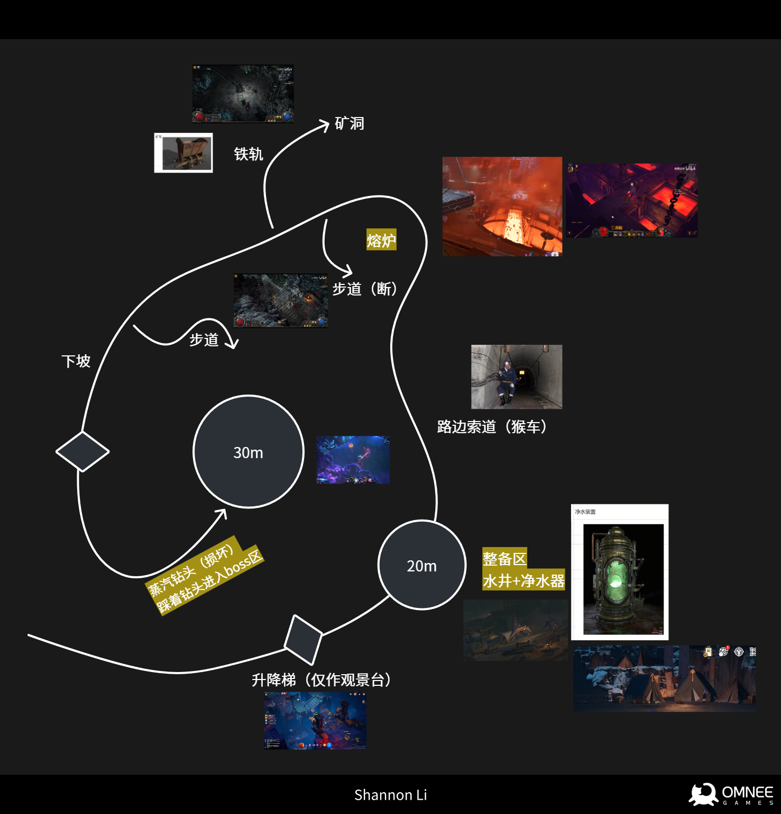
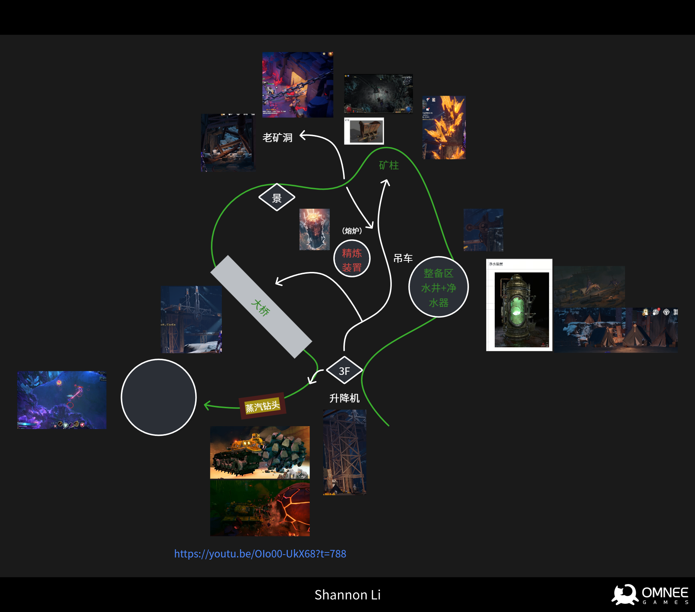
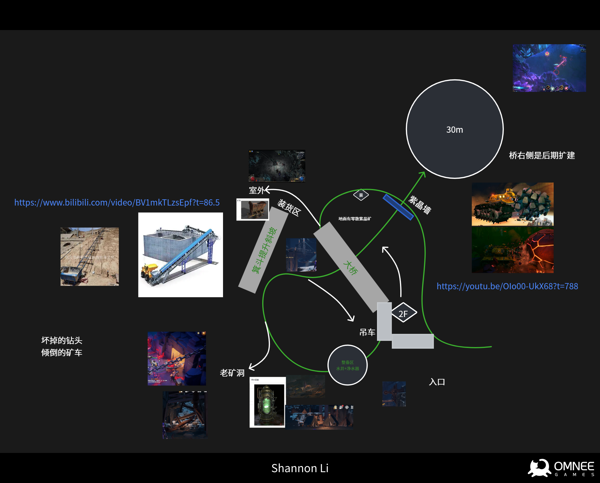
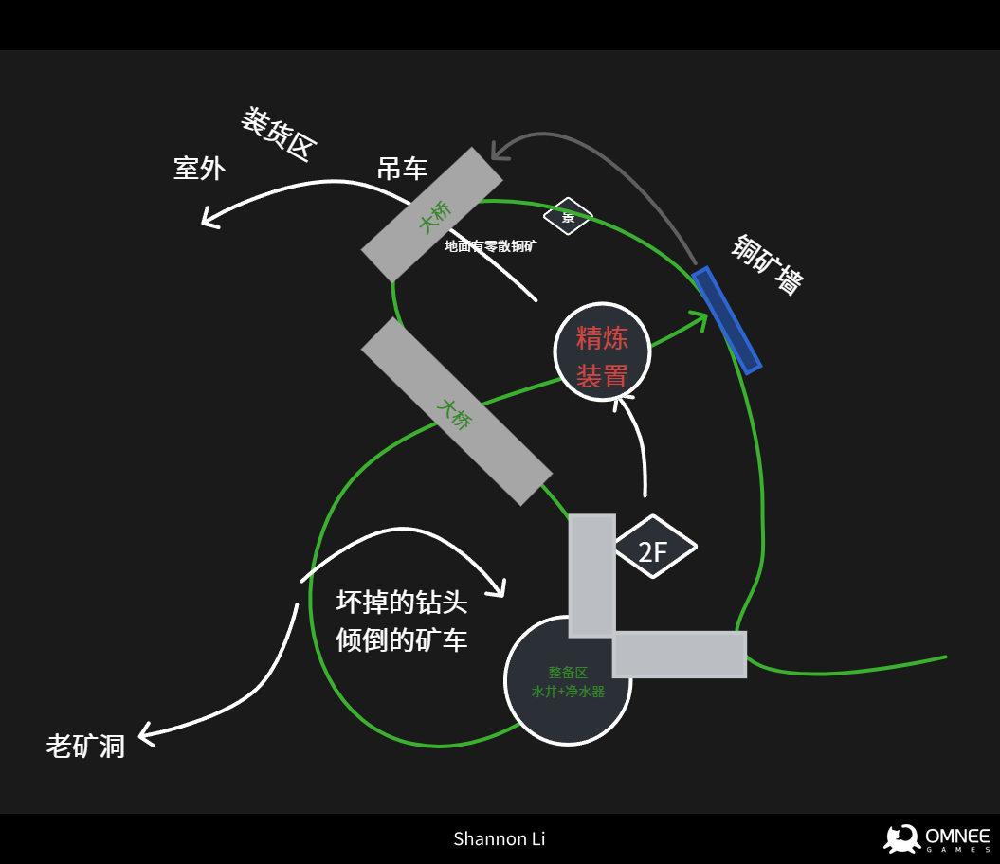
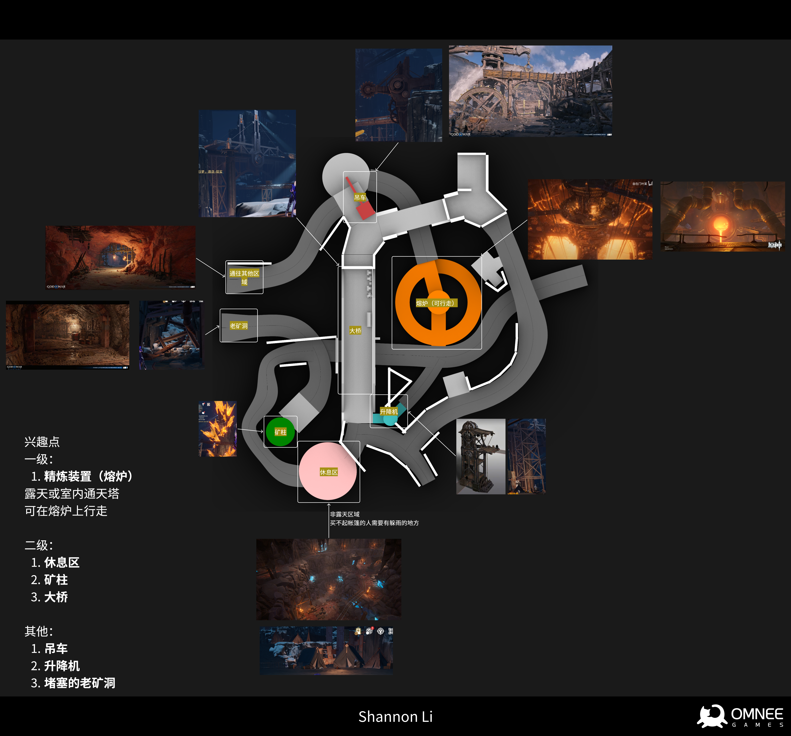
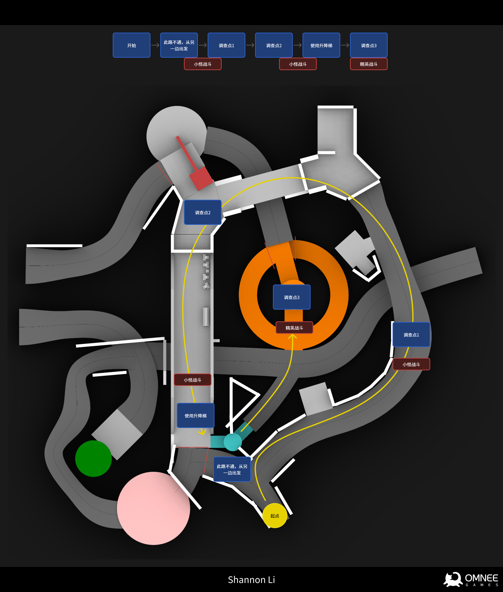
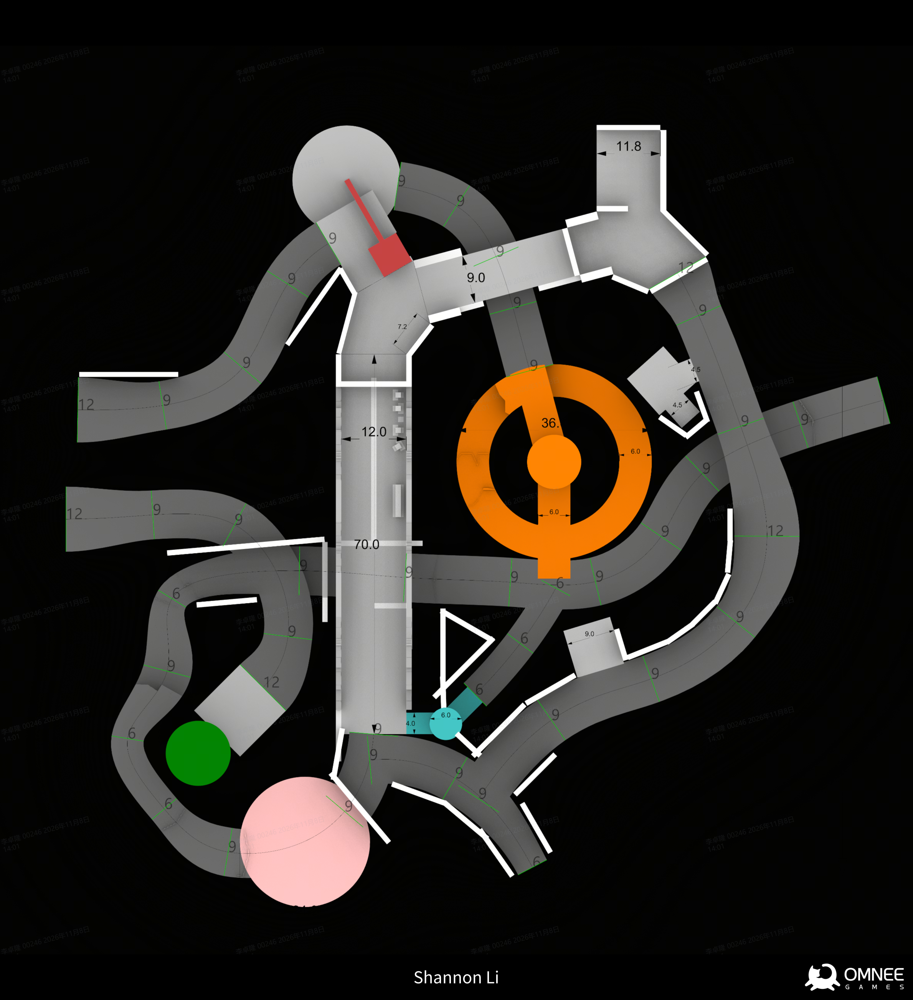
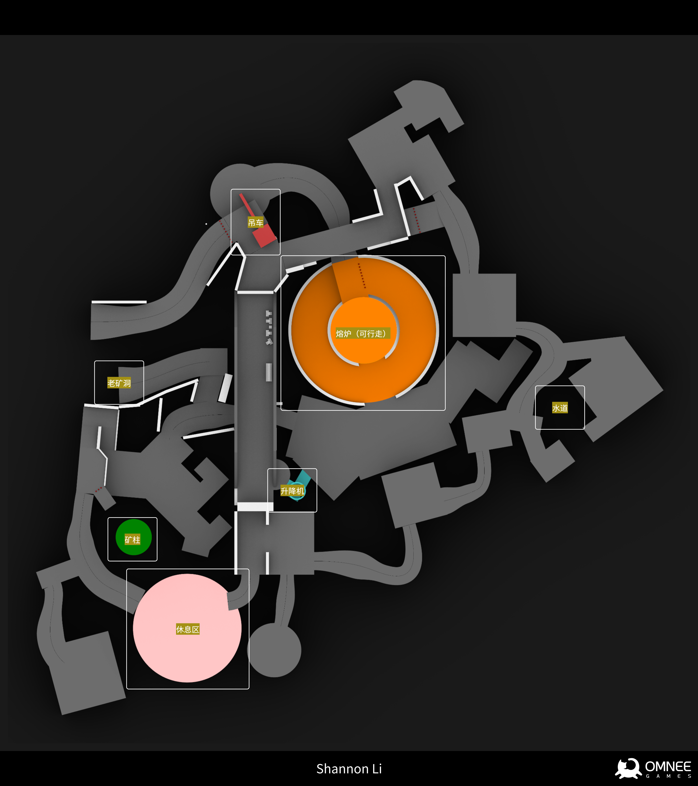
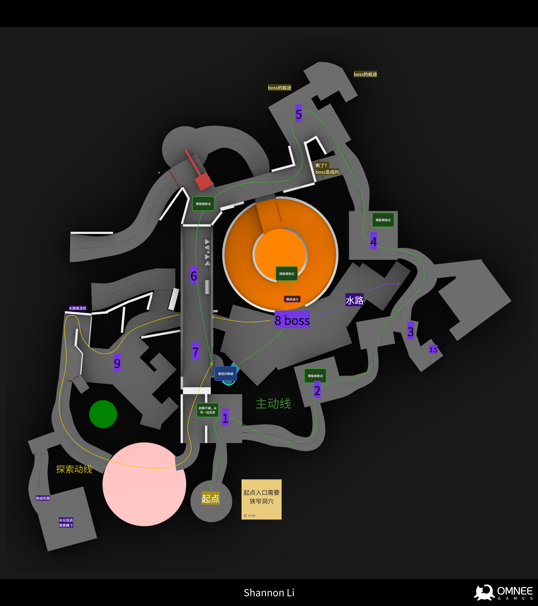
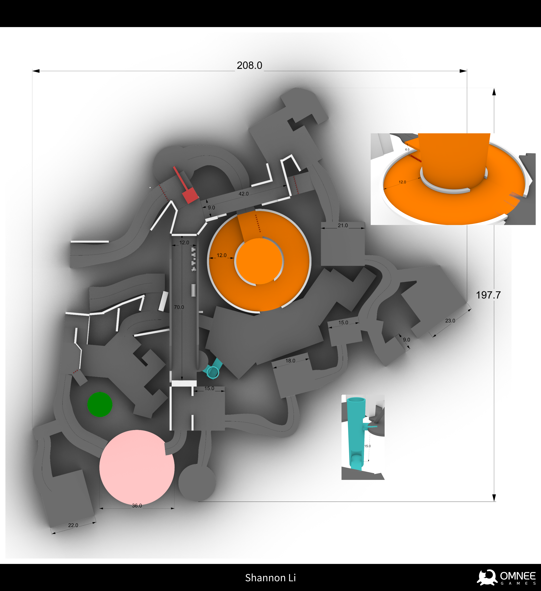

当我需要设计一个全新的关卡时，我会首先关注这样几个内容：

**背景：** 这个关卡是一个什么样的世界？

**规模：** 游戏流程希望持续多长时间？

**体验：** 我们希望带给玩家什么感觉？

## 草图

在得到关于我们游戏即将制作的下一个关卡将以矿洞为主题时，我兴奋地开始查找一些我可以起草的方向。我尝试获取大量关于“矿洞”主题的氛围感受。我想，一个幻想中的矿洞，可取的方向可以包含那些发着光的矿石、巨大而炙热的岩浆和夸张的开采和冶炼设施。整个地图的规模，我控制在200-300米边长的空间内。

在迭代1的时候，我打算以一个巨大的隐秘的紫晶矿洞作为关卡最终的秘密，将紫晶矿洞内外的氛围做出巨大差异。就像是这里的工人正在进行开采，而他们遭遇了紫晶矿洞中一个难以撼动的可怕存在。不过这会让关卡中心的目标全程对玩家不可见，一个隐秘的最终关卡空间在这种情况下不是一个很好的选择。

于是后续的迭代2我打算以一个大型的开采装置作为关卡的核心锚点，并围绕它设计路径，并包含少量探索用的空间。当玩家进入地图的时候，需要穿过一片狭长的甬道，然后首次看到那巨大的开采装置，然后围绕着它，逐渐发现更多的空间，最终来到装置正在开采的紫晶墙。但这个开采装置并没有大到能撑起一片巨大的矿洞空间。

迭代3尝试通过桥梁划分出左右两个区分明显的空间。这样就可以在实际的游戏流程中，预留出关卡在任务结束后，二次探索的空间。

迭代4探索了一个巨大的冶炼装置，柱状的冶炼装置贯通整个矿洞内的空间，并让整个矿洞在探索过程中能够不断带给玩家新的景观和获得感。鉴于这个关卡的最终战斗单独设计了特殊的玩法，因此最终我们将之前几个迭代一直存续的紫晶矿洞单独摘出，在后续需要的时候单独制作。


|迭代1|迭代2|迭代3|迭代4|
| :----------------------------------------------------------: | :----------------------------------------------------------: | :----------------------------------------------------------: | :----------------------------------------------------------: |
|  |  |  ||


看起来不错！

## 白盒

在接下来的白盒过程中，我会着重验证整个关卡的尺度和节奏。玩家移动时的重量感、景观的framing；战斗、任务、玩法要如何在这样一片空间中有机结合起来。

### 迭代1


|                           主体标注                           |                           流程布置                           |                           参考尺寸                           |
| :----------------------------------------------------------: | :----------------------------------------------------------: | :----------------------------------------------------------: |
|  |  |  |


在首个白盒制作完成之后，我们终于有机会将我们的角色投入到地图中，试着调试一下角色移动的重量。作为我们游戏第一个适配3D自由视角跑图的地图，我们也在这个白盒上进行了多次测试，得到了我们角色3C系统的黄金标准。基于这套黄金标准，工作室在后续的地图开发中就有了正式的protocol。

当然，首个白盒在确定了这些内容之后，就迎来了它的迭代。目前可以得到它的一些问题：入口进入后，几乎所有的空间都在狭长的通道中，这种缺少喘息的感觉会让实际跑图相当压抑。尤其是入口内，向右转的一段距离内，其实跑图的感受是相当无趣的。它缺少那些能打动人心的动态。

为了让整个关卡在跑图和探索的过程中获得更多的呼吸感，我以此为目标进行了迭代。

### 迭代2


|                           主体标注                           |                           流程布置                           |                           参考尺寸                           |
| :----------------------------------------------------------: | :----------------------------------------------------------: | :----------------------------------------------------------: |
|  |  |  |


在确认我们白盒的方向后，就可以将白盒投入实际细化了。

## 灰盒

在这一步中，我将测试场景的感受、氛围。我也会关注物体细节上的尺寸和布置，确保我们能将玩家的注意力保持在恰当的地方。







灰盒需要对玩家实际的行走范围进行详细的规定，很多时候，关卡中会出现一些实际并不能通过的区域。这些区域在灰盒中就会被恰当地解释，并为我们工作室才华横溢的关卡美术提供不少灵感与发挥空间。

在对灰盒的后续调整中，我有了更多机会将关卡打磨地更加“实际”。在这个过程中，我和我们出色的美术设计团队一起不断修改和反复改进，直到最终成为在正式游戏中的版本。

我多次向我们的美术团队表达我有多么喜欢这些岩浆，以至于我在灰盒中把水的材质换成红色来让它们能够流动LOL。

## 关卡成果












