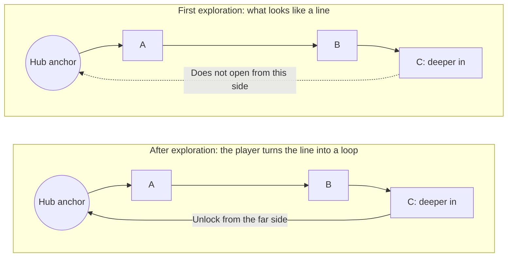

+++
title = "Topology and Level Design"
date = 2026-11-10T00:00:00+08:00
slug = "topology-and-level-design"
draft = false
tags = ["Level design", "Topology"]
categories = ["Design notes"]
description = "From fishbone structures to Souls-style loops: level connectivity, exploration order, and mastery of space."

[library]
css = ["css/topology-note.css"]
+++

## Topology and the “Fishbone”

Topology studies the properties of spaces that remain unchanged under continuous deformation. Its most familiar explanation is that a person, a cup, and a doughnut have the same topological form.

When designing a level around spatial exploration, the topological properties of its connectivity deserve the most attention. At the most abstract level, a **linear level** can be thought of as a straight line, with one-way paths and loops attached to it.

I usually call this kind of map a **“fishbone.”** By a fishbone, I mean one central route with several branches. Generally, the main route is the only path players must take, while the branches must be designed as loops. Players leave the main route to explore a branch, then return to the main route from that branch.

For dungeons in *Diablo IV*, there is more story to carry. A fishbone design can ensure that the story is presented to players “in order.” Players must follow the main route from start to finish in sequence to complete the level. A maze-like layout, by which I mean one with multiple viable paths from start to finish, makes the player's route impossible to predict.

The branches need a special mention here: a fishbone's branches must form loops. In other words, they should not encourage players to explore the same ground repeatedly. If the focus of the level design is the main route and its associated story sequences, then the branches and their gameplay must not steal the show.

### Dark Wood











I have drawn the loops separately on the right. This makes it easy to see that the branches of a fishbone must form individual loops, with areas extending from their ends like synapses. The “one-way gates” are marked with single-direction arrows.

### Horadric Vault









### The Fishbone as a Level Design Pattern

From this analysis, we can see that the fishbone's design proceeds in this order: **main route – loops – synapses**.

Following that order, we can draw a sensible fishbone.

It is worth noting that a fishbone works because there is exactly one path from start to finish, and every branch occupies less space than the main route. If a branch is larger than the main route, the design fails.

Also, by abstracting this route into a straight line through topology, we can clearly see how the whole map connects in the order it is explored.

#### Step 1: Draw the Main Route and Its Branches

Draw a straight line.

Add loops along the main route in the intended order of exploration. If needed, add further loops and synapses outside those loops.

#### Step 2: Topological Transformation

This is cool! In topology, a cup, a doughnut, and a straw have the same form. All we need to do is bend the main route into whatever shape we want, and we can get a pretty fun fishbone map.

Let's try it:









Of course, the same topological operation can turn this fishbone into other maps as well.







It all depends on where we want to place the map's central experience, because topological transformations let us freely control the shape of the main route and the size of its branches.

Flesh out the individual rooms a little from the transformed sketch, and we have a pretty good final version.

## The “Souls-Style” Level Design Pattern

When I first began trying to study and analyze games such as *Dark Souls* and their level design, I came across a very valuable video. It breaks the basic level design of Souls games down into modules and arrives at a highly reusable design pattern.

[Reference video: a modular breakdown of Souls-style level design](https://youtu.be/r7DbgIPDWH0?si=YLxnfWSMkO3I0APH)

### Hubs and Loops

The video repeatedly mentions two key concepts in Souls-style levels: the hub and the loop.

A hub is a familiar anchor point for the player, a safe area, a place they return to again and again.

A loop is a unit of the **level's exploration cycle**.

*On a phone, scroll horizontally to view the flowchart.*

In this example, the familiar “does not open from this side” design represents the basic cycle of a Souls-style level loop.

I think the idea of a cycle (or rotation) is familiar to many players and designers. In WoW and FFXIV, we use “rotation” to describe a complete sequence of skills. In a roguelike, players enter the game, fight, die, and start the process again. A cycle can be understood as **“a system returning to a previous state.”**

The loop creates precisely this return. After a series of adventures, players open a shortcut and return to somewhere they have been before. A loop exists to create a particular level experience, and the Souls-style loop offers this chain of experiences:

> Explore the unknown → Take the risk of not being able to return immediately → Discover a connection → Recognize a familiar place → Build a mental map → Replan the route

In this smallest model of a loop, we can see a classic experiential cycle that any game system can create:

> Intention → Resistance → Action → Feedback → Mastery → New intention

“Resistance” here does not necessarily mean game difficulty. It may come from enemies, resource pressure, an unfamiliar space, route choices, understanding the rules, or the **risk** of not being able to return to safety immediately. Resistance creates a gap between the player's goal and their current abilities, knowledge, and resources. Playing is the process through which players gradually close that gap by acting and learning.

### Shortcuts and Mastery of Space

In this design pattern, the **“shortcut”** is a special mechanism. After players finish exploring a loop, they are given a shortcut as a reward. It rewards the spatial knowledge they have accumulated, much as gaining a stronger ability rewards them for defeating a powerful enemy. A road that was unfamiliar and dangerous becomes familiar and controllable; the shortcut can also serve their future route decisions.

So, on the surface, a Souls-style loop takes players on a long detour, opens a passage, and brings them back to where they started. But its underlying value and purpose is to provide the satisfaction of mastery: moving from not knowing the level to understanding it, from being controlled by the space to knowing how to use it.

### From Player Feedback Back to Design Principles

In another, rather sharper “assessment” of Souls games, I came across this kind of feedback on their level experience:

> The map design in Souls games creates a strong sense of exploration and feedback, with something in it for everyone. The maps are cleverly designed: loops and guidance let players explore most of them without deliberately planning a route, and different paths ultimately lead back to the right main route.
>
> Take clearly differentiated branching paths: you can tell at a glance which one still needs exploring. Or the Undead's tendency to gravitate toward light, and the messages left by other players, which help me find those inconspicuous places and side paths. There are no complex puzzles, and no need to reason out the level. All players have to do is advance cautiously and choose a path they have not taken; eventually, they will reach the end. Failing that, there are plenty of guides to fall back on. Even the traps and ambushes along the way only catch you out the first time.
>
> Following the intricate structure and spatial logic of a Souls map, I can find myself covering every inch of it and connecting its different areas almost without noticing. When the winding path brings you back to Firelink Shrine, that sense of the space coming together is striking.

[Reference video: an assessment of the Souls-style level experience](https://www.bilibili.com/video/BV1eeXMB2E19)

This assessment mentions several quite subjective impressions of Souls-style levels:

1. Players do not need to deliberately plan a route.
2. Branching paths are clearly differentiated and easy to distinguish.
3. Following an unexplored path will always let players complete the game.

Behind these impressions and assessments, there need to be corresponding design patterns and principles to support them:

1. Appropriate route design keeps players from getting lost as much as possible.
2. Deliberately designed route guidance helps players build a spatial understanding.
