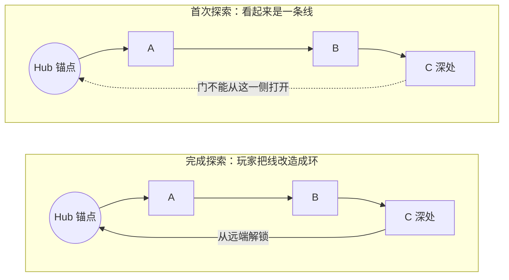

+++
title = "拓扑与关卡"
date = 2026-11-10T00:00:00+08:00
slug = "topology-and-level-design"
draft = false
tags = ["关卡设计", "拓扑学"]
categories = ["设计笔记"]
description = "从鱼骨头结构到魂系回环，讨论关卡连通性、探索顺序与空间掌握。"

[library]
css = ["css/topology-note.css"]
+++

## 拓扑学与“鱼骨头”

作为一门研究空间在连续变形下保持不变性质的学科，其最普遍的解释是人、水杯，和甜甜圈是同一种拓扑形状。

在以空间探索为目的进行关卡设计时，最应关注的就是关卡连通性的拓扑性质。在极端抽象的概念中，**线性关卡**可以被认为是一条直线，加上与这条直线相连的单向线与环线。

这种地图形式，我通常称作**“鱼骨头”**。所谓鱼骨头，指的就是一条核心干道，以及多条支路。通常来说，鱼骨头地图的主干道是唯一玩家必须通行的道路，而支路在设计上必须形成环形道路。玩家从主干道前往支路，最终从支路回到主干道。

对于《暗黑破坏神4》的副本来说，它承载着更多的剧情要素。鱼骨头的设计可以保障剧情一定“按照顺序”呈现给玩家。因为鱼骨头的主干道必须从起点到终点按照顺序行进才可以完成关卡，而迷宫类型（指起点到终点有复数个可行通路的模式）则完全无法预测玩家的路径。

这里需要特殊说明的是支路，鱼骨头的支路必须成环形。也就是，鱼骨头的支路不应当鼓励玩家进行重复探索。关卡设计的侧重点放在主干道和它的相关剧情演出上，那么支路和它的玩法设计便不能喧宾夺主。

### 黑暗林地











我在右侧单独绘制出了环形，可以很明显的看到鱼骨头的支路必须形成一个个环形，然后在末端如突触一般伸出一片区域。“单向阀”被使用了单向箭头标注。

### 赫拉迪姆秘窟









### 鱼骨头，及其关卡设计模式

根据上述分析，我们可以看到鱼骨头的设计从头到尾分别是：**主干道 – 环形 – 突触**。

那么根据这个顺序，就可以绘制一个合理的鱼骨头。

值得注意的是，鱼骨头之所以成立，是因为存在唯一一条从起点到达终点的道路，且每个支路占地面积均小于主干道。如果支路大于主干道，这个设计将是失败的。

此外，将这条通路用拓扑学的手段抽象为一条直线，可以很明晰地看到整个地图按照探索顺序的连接情况。

#### 第一步：绘制主路和支路

画一条直线。

在主干道上，按照设计的探索顺序添加一些环路。如果有需求，可以在环路外额外增加环路和突触。

#### 第二步：拓扑变换

这很酷！因为在拓扑学上杯子、甜甜圈和吸管是同一个形状。我们只需要把主干道弯绕成我们想要的任何形状，就可以获得一个相当好玩的鱼骨头地图。

让我们试试这样操作：









当然了，这样的拓扑操作还可以把同一个鱼骨头操作变换成其他地图。







这完全取决于我们想把地图的核心体验放在哪里，因为通过拓扑变换我们可以随意地控制主干道的形状，以及支路的大小。

按照拓扑变换后的草图稍微绘制一下每个房间的具体样貌，就得到了一个很不错的最终版本了。

## “魂系”关卡的设计模式

在一开始尝试对以《黑暗之魂》为代表的游戏以及它们的关卡设计进行分析学习时，我看到了一个非常有价值的视频，它对魂系游戏的基本关卡设计进行了模块化的拆解，并得到了一个具有高复用性的设计模式。

[参考视频：魂系关卡设计的模块化拆解](https://youtu.be/r7DbgIPDWH0?si=YLxnfWSMkO3I0APH)

### Hub 与回环

该设计模式反复提到魂系关卡的关键概念：Hub与回环。

Hub指的是一个玩家熟悉的锚点，一个安全的区域，一个会被反复到达的地方。

而回环指的是一个**关卡循环**的单元。

*手机上可横向滑动查看流程图。*

以上图为例，“门不能从这一侧打开”这种令人喜闻乐见的设计恰恰就代表了一个魂系回环的关卡设计的基本循环。

我想对于不少玩家以及设计师来说，循环（rotation）都不是一个新鲜的概念。在WOW和FF14中我们会用循环来称呼一整套技能；在Rogue like游戏中，玩家会投入游戏、战斗、死亡，然后重新开始这个进程。循环可以被认为是**“一个系统的状态发生了回归”**。

回环恰恰营造了这种回归。玩家在经历了一系列探险后，打开一处捷径，然后回到了曾经到达过的地方。回环的存在是为了营造某种关卡体验，而魂式回环提供了这样一个体验链条：

> 探索未知 → 承担无法立即返回的风险 → 发现连接 → 认出熟悉地点 → 建立心智地图 → 重新规划路线

可以看到在这个回环的最小模型中，出现了任何游戏系统都会营造的一个经典的体验循环：

> 意图 → 阻力 → 行动 → 反馈 → 掌握 → 新意图

这里的“阻力”不一定等同于游戏难度。它可以来自敌人、资源压力、空间未知、路线选择、规则理解或无法立即返回安全处的**风险**。阻力在玩家的目标与当前能力、知识和资源之间制造差距，而游玩的过程，就是玩家通过行动和学习逐渐弥补这个差距的过程。

### 捷径与空间掌握

在这种设计模式中，**“捷径”**是一个特殊的机制。在完成一个回环的探索后，捷径作为奖励被给予给玩家。这是对玩家完成了空间知识积累的一种奖励，它等价于玩家在战胜强敌后被授予更强大的能力。原本陌生且危险的道路在这一刻变得熟悉、可控；这条捷径更是能够服务于未来的路线决策。

因此，可以认为魂系回环提供的是一个绕了一大圈打开了通路却回到原点的表象，但是它根本的价值与目的是提供掌握的成就感：从对关卡的未知到理解，从被空间支配到懂得利用。

### 从玩家反馈回到设计原则

而在另一个较为尖锐的魂系游戏“评价”中，我得到了对于魂系关卡体验的一类反馈：

> 魂游的地图设计能带来很强的探索感和反馈，老少皆宜雅俗共赏。地图设计十分巧妙，回环和引导让玩家不用特意构建路线也能探索的七七八八，并殊途同归走上正确的主线。
>
> 比如差异化明显的岔路，一眼便能分辨出哪一条还亟待探索。比如不死人的趋光性引导和玩家的谏言，让我能发现那些不起眼的地方和小路。它没有复杂谜题，也不需要关卡推理，玩家要做的就是谨慎推进，选择一条未走过的路走下去，总能到达终点。再不济也有大量攻略兜底。而路上那些陷阱和偷袭，也不过是初见杀。
>
> 顺着魂游最精妙的结构设计和空间逻辑，我能不知不觉地走遍每一寸土地，将不同的区域联通起来。当你峰回路转回到传火祭祀场时，便会被那种空间贯通感震撼到。

[参考视频：关于魂系关卡体验的评价](https://www.bilibili.com/video/BV1eeXMB2E19)

这段评价中，提到了一些对于魂系游戏关卡相当主观的感受：

1. 玩家并不需要刻意构筑路线
2. 岔路差异化明显易于分辨
3. 选择未完成的路走一定能够通关

这种评价与感受的背后，是需要与之对应的设计模式和理念去承载的：

1. 恰当的路线设计尽可能规避迷路
2. 经过设计的路线引导让人建立空间认知
